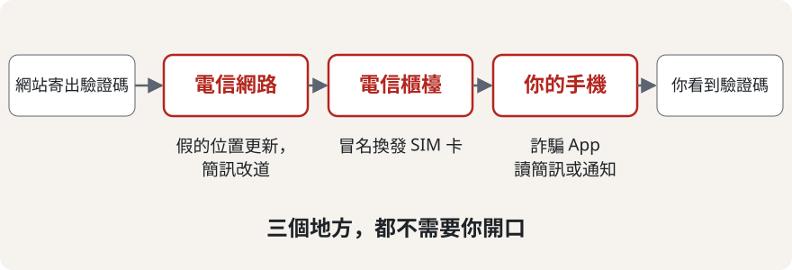
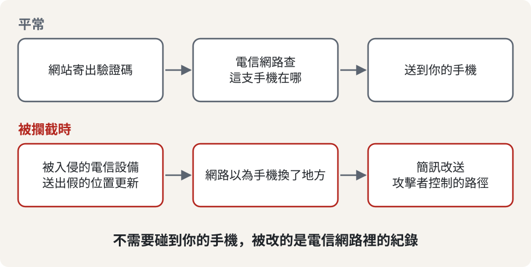
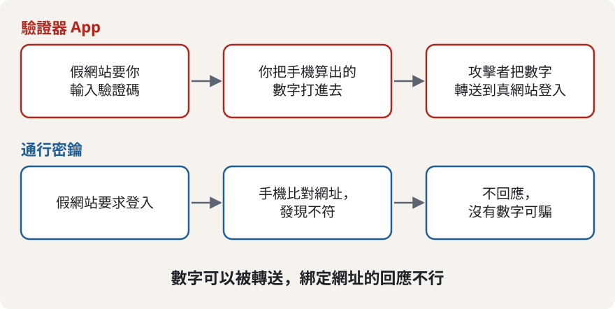
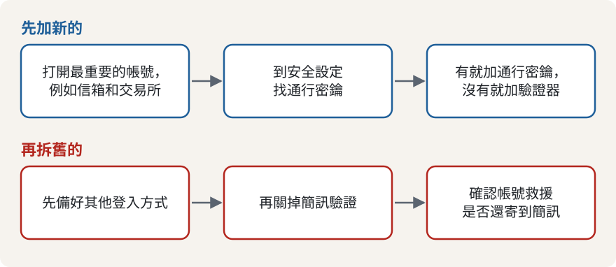

# 驗證碼沒交出去，還是到了別人手上：讀區塊勢〈別再用簡訊驗證碼！〉

> 本導讀的分析與撰稿由 AI 模型完成，不是人類分析，也沒有經過人工逐句校稿。影片沒有字幕軌，影片引言依畫面上的字幕擷取；TVBS 受訪者的話依 TVBS 新聞網文字稿。

> 導讀的影片：區塊勢 YouTube 頻道〈別再用簡訊驗證碼！即便你沒給任何人，它還是會被攔截！重要帳號該換掉簡訊驗證〉，2026 年 11 月 19 日上架，長 4 分 41 秒，由區塊勢創辦人許明恩旁白、搭配動態圖解。[YouTube 原影片](https://www.youtube.com/watch?v=pA9gXxCqkYQ)｜[中文字幕播放器](player.html)

沒有人把驗證碼交出去，驗證碼還是到了別人手上。

資安公司 Enea 在 2026 年 11 月 11 日公布的[研究](https://www.enea.com/insights/the-enemy-within-tracking-liminal-panda-and-silentair-through-mobile-networks/)裡，記下了這樣的現象：有些人的簡訊在電信網路裡被攔截，緊接著就出現一則登入用的驗證碼（[00:11](https://www.youtube.com/watch?v=pA9gXxCqkYQ&t=11s)）。Enea 研判，攻擊者的目的之一是闖進這些人的其他帳號。受害者沒有點錯連結，也沒有接到假客服電話，整件事發生在他們看不到的地方。

許明恩在這支影片裡講的就是這件事，結論只有一句：重要的帳號，別再靠簡訊驗證碼，改成在你自己的裝置上驗證（[00:34](https://www.youtube.com/watch?v=pA9gXxCqkYQ&t=34s)）。以下順著影片走一遍，補上它來不及說的幾個條件。

## 三十秒版

1. **簡訊驗證碼只認「誰讀到那則簡訊」。**網站寄出去以後就不管了，誰讀到誰過關。
2. **有三個地方可以在你看到之前讀走它：**電信網路（假的位置更新把簡訊改道）、電信櫃檯（冒名換發 SIM 卡）、你自己的手機（詐騙 App 拿到讀簡訊或讀通知的權限）。三個都不需要你開口。
3. **驗證器 App 把驗證碼搬到手機上自己算**，電信那兩段碰不到；但它產生的數字仍可能被假網站騙走。
4. **通行密鑰（passkey）不用打數字**，假網站騙不走。Google 中文介面稱它「密碼金鑰」。
5. **加了新方法，簡訊不會自己消失。**先備好其他登入方式，再回頭把簡訊關掉；帳號救援流程也可能還在用簡訊。

## 簡訊驗證碼只認一件事

大家學到的規矩是：只要不把那組數字告訴別人，帳號就安全（[00:22](https://www.youtube.com/watch?v=pA9gXxCqkYQ&t=22s)）。這條規矩防的是詐騙電話和假客服，它預設數字只會出現在你的手機上，唯一的外洩管道是你的嘴。

影片把這個預設拆掉了。網站把驗證碼寄出去以後，「只看誰讀到那則簡訊，誰讀到，誰就過關」（[00:55](https://www.youtube.com/watch?v=pA9gXxCqkYQ&t=55s)）。網站驗證的是「這個門號收得到簡訊」，它沒有辦法知道收到簡訊的是不是你手上那支手機。

> 重點：驗證碼從網站出發到你看見之前，經過的每一站都是可以讀走它的地方。

影片點出三站。

*圖：簡訊驗證碼從網站寄出到你看見之前，影片點出的三個可被讀走的地方。本文依影片整理。*

### 第一站：電信網路

簡訊要送到你手上，電信網路得先知道你的手機現在在哪裡（[01:06](https://www.youtube.com/watch?v=pA9gXxCqkYQ&t=66s)）。各國電信業者之間靠一套互相傳話的系統交換這類資訊，手機出國漫遊時，當地業者就是靠它告訴你的業者「這支手機現在在我這裡」。Enea 追到的組織 SilentAir 就是從這裡下手：它躲在已經被入侵的電信業者設備裡，冒用這套系統送出假的位置更新，告訴網路這支手機換了地方，之後的簡訊和電話就改送到攻擊者控制的路徑（[01:12](https://www.youtube.com/watch?v=pA9gXxCqkYQ&t=72s)）。

*圖：Enea 描述的攔截手法，本文以白話簡化，不含實際信令細節。*

影片說「整個過程不需要碰到你的手機」（[01:24](https://www.youtube.com/watch?v=pA9gXxCqkYQ&t=84s)）。這種攔截也不會永久有效，手機過一段時間會自己重新向網路登記真實位置。Enea 還觀察到 SilentAir 大量發送一種收到時不會顯示、不會響的「無聲簡訊」，**主要送往台灣的使用者**；用途沒有確認，Enea 研判其中一個可能是測試先前的攔截還在不在。

影片說「主要目標是台灣」（[00:09](https://www.youtube.com/watch?v=pA9gXxCqkYQ&t=9s)），Enea 原文也這樣寫，並補了一句「但不是唯一目標」。報告標題裡的另一個名字 LIMINAL PANDA 是另一個組織，Enea 說兩者可能有關聯但未經證實；至於 SilentAir 與中國網路行動有關，Enea 只給低信心。

### 第二站：電信櫃檯

第二站的手法更老。歹徒冒充你，或買通電信公司員工，把你的門號換發到一張新的 SIM 卡上，之後寄給你的驗證碼就送到他手上（[01:27](https://www.youtube.com/watch?v=pA9gXxCqkYQ&t=87s)）。這種手法叫 SIM 換卡（SIM swap）。[美國 FBI 網路犯罪申訴中心](https://www.ic3.gov/PSA/2022/PSA220208)光是 2021 年就收到 1,611 件這類投訴，調整後的損失超過 6,800 萬美元（[01:38](https://www.youtube.com/watch?v=pA9gXxCqkYQ&t=98s)）。

台灣也發生過。[TVBS 2022 年報導](https://news.tvbs.com.tw/life/1705527)，一位人在海外工作的 A 先生，門號被人用變造的身分證掛失補發走了（[01:48](https://www.youtube.com/watch?v=pA9gXxCqkYQ&t=108s)）。影片引用了他受訪的片段（[01:57](https://www.youtube.com/watch?v=pA9gXxCqkYQ&t=117s)），TVBS 報導裡的文字是：

> 「我是本人，是正主，是去把它(門號)鎖起來，是要求停話但停完之後它立刻被解開，而且電信公司就給他(歹徒)解了，即使我反映了之後，電信公司還是讓他解(鎖)。」

櫃檯一旦信了冒名者，**連正主出面都未必搶得回門號**。

### 第三站：你自己的手機

第三站離你最近。Google 的資安團隊說明過，詐騙 App 常常要求讀取簡訊、讀取通知的權限，**拿到之後就能在背景把驗證碼讀走**（[02:24](https://www.youtube.com/watch?v=pA9gXxCqkYQ&t=144s)）。Google 那篇 2024 年的[文章](https://security.googleblog.com/2024/02/piloting-new-ways-to-protect-Android-users-from%20financial-fraud.html)談的是 Android 上不經應用程式商店、直接下載安裝的 App；它列出的常被濫用權限還有一項「無障礙」，可以窺看螢幕內容。

回到開頭那條規矩：三站沒有一站需要你開口把驗證碼告訴別人（[02:33](https://www.youtube.com/watch?v=pA9gXxCqkYQ&t=153s)）。

## 把驗證從門號搬到裝置上

影片的第二章回答：不靠簡訊，還有什麼方式能證明登入的是你本人？答案是用你手上的手機就能做，而且這些方式不經過電信，把驗證這件事「從門號搬到你自己的裝置上」（[02:47](https://www.youtube.com/watch?v=pA9gXxCqkYQ&t=167s)）。

| 比較項目 | 簡訊驗證碼 | 驗證器 App | 通行密鑰（passkey） |
|---|---|---|---|
| 驗證碼從哪來 | 網站經電信寄來 | 手機用事先約好的秘密自己算 | 不用數字，解鎖手機後由手機回應網站 |
| 電信網路改道 | 擋不住 | 碰不到 | 碰不到 |
| 冒名換發 SIM 卡 | 擋不住 | 碰不到 | 碰不到 |
| 詐騙 App 讀簡訊或通知 | 擋不住 | 讀不到；但 Google 列出的濫用權限也包括能窺看螢幕的「無障礙」 | 影片未討論 |
| 假網站騙你輸入 | 擋不住 | 仍可能被騙走 | 騙不走 |

*表：本文依影片、CISA 指引、NIST 數位身分指引、Google 說明頁與 Google 資安部落格整理。*

### 驗證器 App：數字還在，但不再經過電信

第一種是驗證器 App，例如 [Google Authenticator](https://support.google.com/accounts/answer/1066447?hl=zh-Hant)。設定的時候，網站和你的手機先約好一組秘密，之後由手機自己算出一次性的數字（[02:57](https://www.youtube.com/watch?v=pA9gXxCqkYQ&t=177s)）。這組數字不是寄來的，手機沒有網路、沒有訊號也算得出來（[03:04](https://www.youtube.com/watch?v=pA9gXxCqkYQ&t=184s)），電信網路和電信櫃檯都碰不到它。影片舉[幣安](https://www.binance.com/en/support/faq/detail/b53000f9a9c4406db5f93a8f8e7475f6)為例，它把驗證器列為驗證選項之一（[03:11](https://www.youtube.com/watch?v=pA9gXxCqkYQ&t=191s)）。

影片沒講的是，美國網路安全主管機關 CISA 的[指引](https://www.cisa.gov/sites/default/files/2024-12/guidance-mobile-communications-best-practices.pdf)寫明：驗證器的數字比簡訊好，**但仍然可能被釣魚**。數字終究要你自己打進去，打進假網站，一樣會被即時拿去用。

### 通行密鑰：假網站騙不走

更進一步的是通行密鑰，英文叫 passkey（[03:14](https://www.youtube.com/watch?v=pA9gXxCqkYQ&t=194s)）。登入時不用打任何數字，只要用指紋或臉打開手機的螢幕鎖，由手機裡的通行密鑰替你回答網站（[03:18](https://www.youtube.com/watch?v=pA9gXxCqkYQ&t=198s)）。影片的說法是「它只認真的網站，假網站騙不走，你的指紋和臉也不會離開手機」（[03:26](https://www.youtube.com/watch?v=pA9gXxCqkYQ&t=206s)）。

通行密鑰建立時就記住了網站的網址。**假網站長得再像，網址不同，手機就不會替它回應**，你也沒有任何數字可以被騙著打出去。美國國家標準與技術研究院（NIST）的[數位身分指引](https://pages.nist.gov/800-63-4/sp800-63b.html)把這種「綁定網址」列為抗釣魚的方法之一；Google 的[說明頁](https://support.google.com/accounts/answer/13548313?hl=zh-Hant)則寫明，指紋或人臉解鎖用的生物辨識資料「只會儲存在裝置上」。

*圖：本文依 CISA 指引與 NIST 數位身分指引整理。*

**要在 Google 帳戶設定裡找它，名字是「密碼金鑰」**，指的就是通行密鑰。影片接著放了一段 Google 的官方教學：在支援的網站和 App，瀏覽器或作業系統會提示建立通行密鑰，之後登入時只會提示你解鎖裝置（[03:34](https://www.youtube.com/watch?v=pA9gXxCqkYQ&t=214s)）。

## 今天就做的一件事，以及做完之後的一眼

影片最後給的動作很具體：打開你最重要的帳號，像信箱和交易所，到安全設定裡找通行密鑰，有就加上去，沒有就加驗證器（[04:03](https://www.youtube.com/watch?v=pA9gXxCqkYQ&t=243s)）。加完再看一眼，簡訊是不是還留在那裡當備用（[04:11](https://www.youtube.com/watch?v=pA9gXxCqkYQ&t=251s)）。

*圖：本文依影片步驟整理，並補上 CISA 提醒的帳號救援檢查。*

這一眼省不得。加了新的驗證方式，舊的簡訊驗證不會自動關掉（[04:15](https://www.youtube.com/watch?v=pA9gXxCqkYQ&t=255s)），**簡訊留著，攻擊者就還有一條路可走**。影片把「先準備好別的備用登入方式，再把簡訊關掉」（[04:23](https://www.youtube.com/watch?v=pA9gXxCqkYQ&t=263s)）也一起歸給 CISA；CISA 原文只寫「加了驗證器不會自動取消簡訊，加完就把簡訊關掉」，先備好備用方式是影片補上的順序，NIST 也建議至少保有兩種驗證方式。

做完之後還有兩件事：

- **帳號救援可能還在用簡訊。**CISA 提醒，有些服務在帳號救援流程預設走簡訊，不一定能完全拿掉。驗證方式換好了，記得也看一下「忘記密碼」的流程最後寄到哪裡。
- **手機本身變成鑰匙。**Google 說明頁提醒，裝置上建立密碼金鑰後，任何能解鎖這支裝置的人都能存取你的 Google 帳戶。螢幕鎖不能太簡單，也不要讓別人登記指紋。

## 誰察覺得到，誰擋得住

影片給的是使用者能做的事。換個角度問「誰察覺得到攔截」，就看得出為什麼答案是換掉驗證方式，光靠提高警覺不夠。

| 攔截的地方 | 使用者察覺得到什麼 | 電信、銀行或平台能做什麼 |
|---|---|---|
| 電信網路 | 幾乎沒有可依靠的徵兆；無聲簡訊設計成不顯示，偶爾露出來時也只像一則垃圾廣告簡訊 | 電信業者用「信令防火牆」（過濾業者之間異常傳話的設備）偵測假的位置更新；Enea 說這類攻擊初期很難偵測與阻擋 |
| 電信櫃檯 | FBI 建議留意簡訊收發是否突然異常；陌生的綁定或帳號救援通知 | 電信業者換卡前嚴格核對身分；銀行送驗證碼前查門號是否剛換過 SIM 卡 |
| 你的手機 | 安裝來源不是官方商店、App 要求讀簡訊或讀通知等與功能無關的權限 | Google 在新加坡試辦，安裝時自動擋下要求這類權限的 App |

*表：本文依 Enea、FBI IC3、NIST、中華電信與 Google 原文整理。*

規範面，CISA 直接建議別用簡訊當第二道驗證，也建議為電信帳戶加設 PIN 碼與多重驗證，降低被換卡的風險；NIST 把簡訊驗證列為「受限制」的驗證方式，並建議寄送簡訊驗證碼前，先看換 SIM 卡、攜碼（把門號轉到別家電信）這類風險訊號。台灣有一個銀行端的實例：中華電信與臺灣企銀 [2025 年合作](https://www.cht.com.tw/zh-tw/home/cht/messages/2025/0709-1550)，客戶做電子支付綁定交易時，銀行即時向中華電信查詢門號近期有沒有異常的 SIM 卡更換紀錄，新聞稿講的範圍只有這家銀行、這類交易。

SilentAir 跟一般人有沒有關係？Enea 的原文兩面都寫了。目標「包括」政治與政府要人，多國節點聯手鎖定要人的情形屬於例外；台灣使用者是主要的外部目標，一波攻擊從單一或少數使用者到一個月數千人都有。沒有一手來源說一般民眾正被大規模攔截簡訊。不過，**SIM 換卡和詐騙 App 本來就是衝著一般人來的犯罪**，「別靠簡訊」的結論對一般人一樣成立。

## 讀這支影片要記得的限制

- **影片是給一般使用者的四分半鐘提醒**，挑最重要的帳號先換是合理的起點，沒有討論企業帳號、工作用手機或無法使用智慧型手機的人。
- **CISA 那份指引主要寫給「高度被鎖定的人」**，指政府高層與政治人物，CISA 也說內容適用所有人。照它的分級，驗證器只建議用在較不重要的帳號，最推薦的是 Yubico、Google Titan 這類插在電腦或靠近手機使用的實體安全金鑰，通行密鑰是可接受的替代。影片「沒有通行密鑰就加驗證器」，是網站不支援通行密鑰時的折衷。
- **SilentAir 的研究來自單一資安公司的觀測**，Enea 自己也說真實規模可能涉及數十個國家；它認為 SilentAir 是國家級攻擊者，與中國的關聯則如前述只給低信心。

## 製作說明：這篇導讀由 AI 模型完成

本導讀的分析、撰稿、查證與審稿皆由 AI 模型完成，不是人類分析，也沒有經過人工逐句校稿。主控與撰稿為 Claude Opus 5.5。影片沒有字幕軌，逐字稿由 Claude Opus 5.5 逐張讀取影片畫面上的燒入字幕擷取，再以本機 Whisper 語音轉寫交叉比對；引言的時間依畫面字幕切換點偵測，可能有一兩秒誤差。查證由 agy（Google 的 Antigravity 命令列工具，用 gemini-3.8-flash-high）與 Claude Opus 子代理人各自獨立進行，重要說法須兩方一致且有官方或第一手來源才寫成確定事實，否則降級標示。資安面向的攻防對照，先依資安導師框架整理成分析備忘，再由撰稿人取用。完稿後由兩位 Claude Opus 審稿人分別把關事實與歸屬、編輯與可讀性，修改後再由一位 Claude Opus 終審，最後由 Claude Opus 依一份潤稿準則調整語句並標示重點。文中四張流程圖由 Claude 撰寫 SVG 腳本產生，本文沒有使用 AI 生圖。中文字幕見[字幕播放器](player.html)。

## 來源清單

- [區塊勢：〈別再用簡訊驗證碼！即便你沒給任何人，它還是會被攔截！重要帳號該換掉簡訊驗證〉](https://www.youtube.com/watch?v=pA9gXxCqkYQ)，2026-11-19
- [Enea：The Enemy Within. Tracking LIMINAL PANDA and SilentAir through Mobile Networks](https://www.enea.com/insights/the-enemy-within-tracking-liminal-panda-and-silentair-through-mobile-networks/)，2026-11-11
- [iThome：〈國家級駭客組織 SilentAir 鎖定臺灣等十多個國家的手機用戶〉](https://www.ithome.com.tw/news/180533)，2026-11-16
- [FBI IC3：Criminals Increasing SIM Swap Schemes to Steal Millions of Dollars from US Public（PSA220208）](https://www.ic3.gov/PSA/2022/PSA220208)，2022-02-08
- [TVBS 新聞網：〈個資、手機SIM卡遭掌握！歹徒冒用身分 受害者百萬積蓄沒了〉](https://news.tvbs.com.tw/life/1705527)，2022-01-31
- [Google Online Security Blog：Piloting new ways of protecting Android users from financial fraud](https://security.googleblog.com/2024/02/piloting-new-ways-to-protect-Android-users-from%20financial-fraud.html)，2024-02-06
- [Google 帳戶說明：透過 Google Authenticator 取得驗證碼](https://support.google.com/accounts/answer/1066447?hl=zh-Hant)
- [Google 帳戶說明：以密碼金鑰登入](https://support.google.com/accounts/answer/13548313?hl=zh-Hant)
- [Binance：How to Activate 2FA Verification](https://www.binance.com/en/support/faq/detail/b53000f9a9c4406db5f93a8f8e7475f6)
- [Chrome for Developers：Understand passkeys in 4 minutes](https://www.youtube.com/watch?v=2xdV-xut7EQ)
- [CISA：Mobile Communications Best Practice Guidance](https://www.cisa.gov/sites/default/files/2024-12/guidance-mobile-communications-best-practices.pdf)，2024-12-18
- [NIST：SP 800-63B Digital Identity Guidelines: Authentication and Authenticator Management（800-63-4）](https://pages.nist.gov/800-63-4/sp800-63b.html)
- [中華電信：〈中華電信助力臺灣企銀推動金融防詐 自主研發通信防詐API〉](https://www.cht.com.tw/zh-tw/home/cht/messages/2025/0709-1550)，2025-07-09
- [區塊勢：關於](https://blocktrend.substack.com/about)
- [延伸閱讀：區塊勢第 702 期〈史上最大密碼外洩！中國推出國家登入、蘋果加速升級通行密鑰〉](https://www.blocktrend.today/p/702)
